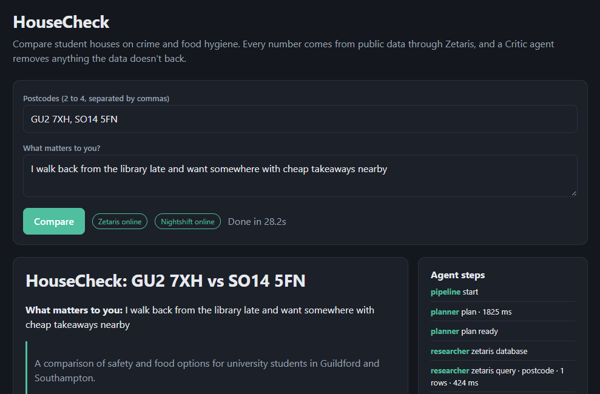

# HouseCheck



**Compare student houses before you sign, with every claim traced to public data.**

Open Agent Hackathon 2026 · Track 1: Fragmented Intelligence · Team *It Works On My Machine*

Every year thousands of second-years pick a house for next year in a rush, on a landlord's word. What the area is actually like is public, but it's split across sites that don't talk to each other: police.uk for crime, the FSA for food hygiene, postcodes.io for which council and ward you're in. They use different geographies, they update at different times, and sometimes they disagree.

HouseCheck takes 2 to 4 postcodes and what you care about ("I walk back from the library late"), pulls all of it through **Zetaris**, reconciles it in a **Meterless World Model**, and has **NVIDIA Nemotron (via Meterless Nightshift)** write a plain-English comparison. A **Critic** agent checks every sentence against the data and removes anything it can't back.

## How it works

```
postcodes + priorities
   │
   ▼
Planner (Nemotron) ── turns "I walk home late, had a bike stolen" into weights + crime types to highlight
   │
   ▼
Researcher ── registers each source in Zetaris as a Lightning REST table, queries it with SQL
   │            stage 1: postcodes.io → coordinates, council, ward
   │            stage 2: those coordinates → police.uk crime + neighbourhood, FSA ratings within 0.5 mi
   ▼
World Model (Meterless engine) ── one shared record per address: stable IDs, idempotent ingest,
   │                               provenance (source + exact SQL) on every fact, conflict view
   ▼
Critic, pass 1 ── conflicts between sources, thin samples, stale data
   │
   ▼
Reporter (Nemotron) ── writes claims; every claim must cite World Model fact IDs
   │
   ▼
Critic, pass 2 ── every number in every sentence must match a cited fact for that address.
                  Rejected claims go back to the Reporter once; still wrong → removed and listed.
   │
   ▼
Report: side-by-side table, fit-for-your-priorities ranking, sourced claims, Critic flags, removed claims, SQL behind every source
```

Every step is logged to `runs/<run_id>/trace.jsonl`.

## Sponsor technology

| | Where | What it does |
|---|---|---|
| **Zetaris** | `housecheck/zetaris.py`, `housecheck/sources.py`, `agents/researcher.py` | The only way HouseCheck reaches data. Each public API is registered at run time as a `CREATE LIGHTNING REST TABLE`; counts are aggregated in Zetaris SQL (`GROUP BY`, `LATERAL VIEW explode`). The second-stage tables are registered with coordinates Zetaris returned in the first. |
| **Meterless Nightshift + NVIDIA Nemotron** | `housecheck/llm.py`, `agents/planner.py`, `agents/reporter.py` | All model calls go through the Nightshift runtime (OpenAI-compatible, Meterless provider contract headers) to Nemotron lanes. Reasoning tokens are stripped; invalid JSON goes back to the model once. |
| **Meterless World Model engine** | `housecheck/world_model.py` | Python implementation of the World Model engine: stable IDs **byte-identical to the Meterless reference** (checked against vectors from its own code), idempotent ingest, no write without provenance, bitemporal relationships, audit log, `current_facts` and `conflicts` views. Passes all 8 checks of the official conformance suite, ported to Python. The Researcher writes it; the Critic and Reporter only read it. |
| **Coding assistant** | whole repo | Built with Claude as the coding assistant (see Team). |

More detail: [`docs/sponsor-technology.md`](docs/sponsor-technology.md).

## Zetaris Unified Semantic Layer: `student_area`

`housecheck usl run "PC1, PC2, PC3"` builds a governed model over the three sources and records every statement and result in [`docs/usl/RESULTS.md`](docs/usl/RESULTS.md):

| Zetaris criterion | Where |
|---|---|
| 1a use case, 3+ sources | [`docs/usl/USE_CASE.md`](docs/usl/USE_CASE.md) |
| 1b onboard + 2–3 exploratory queries per source | [`sql/01_onboard.sql`](sql/01_onboard.sql), [`sql/02_explore.sql`](sql/02_explore.sql) (9 queries) |
| 1c USL + DDL, queries showing it active, DQ rule executed | [`sql/04_usl.sql`](sql/04_usl.sql) (`COMPILE USL student_area`, 4 tables, 4 `REGISTER DQ`, `RUN DQ`), [`sql/05_usl_queries.sql`](sql/05_usl_queries.sql) (4 queries) |
| 2a time saved vs hand-coded (+ bonus) | [`docs/usl/REFLECTION.md`](docs/usl/REFLECTION.md), [`scripts/handcoded_council_check.py`](scripts/handcoded_council_check.py) |
| 2b would it help my work (+ forecast) | [`docs/usl/REFLECTION.md`](docs/usl/REFLECTION.md) |
| 2c PM requirement (+ mocked feature and USL) | [`docs/usl/REFLECTION.md`](docs/usl/REFLECTION.md): parameterised REST sources |

The model: `area` (postcodes.io), `police_area` and `street_crime` (police.uk), `food_establishment` (FSA), keyed on postcode. Query 3 in `05_usl_queries.sql` is the cross-source check the agents rely on: does postcodes.io agree with the FSA about which council covers the area?

## Run it

Needs Python 3.10+, a running Zetaris platform with an API key, and Nightshift with an NVIDIA key.

```bash
python -m venv .venv && source .venv/bin/activate     # Windows: .venv\Scripts\activate
pip install -e ".[dev]"
cp .env.example .env                                   # add ZETARIS_API_KEY (and the Nightshift token if not auto-found)

housecheck doctor                                      # checks every Zetaris and Nightshift step, one by one
housecheck usl run "GU2 7XH, PC2, PC3"                 # builds the Zetaris USL, runs DQ, writes docs/usl/RESULTS.md
housecheck compare "GU2 7XH, GU1 1AA" -p "I walk home from campus late"
housecheck serve                                       # http://127.0.0.1:8000
```

**No keys?** `housecheck compare "GU2 7XH, GU1 1AA" --mode sample` replays answers recorded from earlier Zetaris runs in `data/samples/` (every live run records them). The report says clearly when data was replayed.

**WSL networking.** Zetaris in WSL is reachable from Windows on `localhost`, but WSL can't reach Windows' `localhost` by default. If HouseCheck runs in WSL and Nightshift on Windows, either add `networkingMode=mirrored` under `[wsl2]` in `%UserProfile%\.wslconfig` (then `wsl --shutdown`), or run HouseCheck from Windows.

**Docker:** `docker build -t housecheck . && docker run -p 8000:8000 --env-file .env housecheck` (set the URLs to `host.docker.internal`).

## Tests

```bash
pytest
```

30 tests, no network: the Meterless World Model conformance checks and reference ID vectors, World Model idempotency and conflict detection, the Critic rejecting invented and computed numbers, the Zetaris USL SQL, and an end-to-end run where a fake Nemotron invents a number, the Critic sends it back, and the revision passes.

## Limits (the Critic says these out loud too)

- police.uk is one month of street-level crime within about a mile, with locations snapped to anonymous points. Small differences are noise.
- FSA ratings cover food businesses only, and near a council boundary they can come from the neighbouring council; HouseCheck flags that as a conflict rather than hiding it.
- Scores are relative to the addresses compared, not absolute.

## Team

It Works On My Machine. Built by Jacob Baker, with Claude as an AI coding assistant; design decisions, live testing and the write-ups are mine.

MIT licence.
