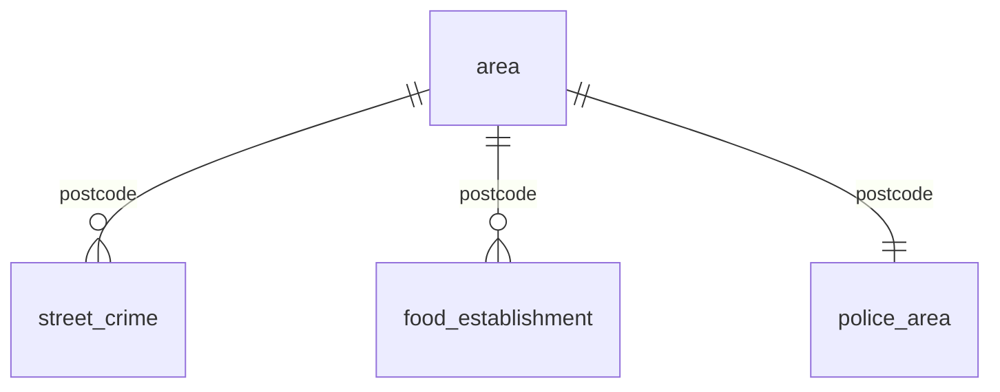

# 1a. Use case and data sources

## The use case

Every autumn, second-year students choose a house for the following year, usually within a few weeks and often on a landlord's or the previous tenants' word. The questions they actually ask ("Is it OK walking back late?", "Are the takeaways nearby any good?", "Which council do I report problems to?") have public answers, but those answers are split across services that use different geographies and update at different times.

HouseCheck lets a student compare 2 to 4 postcodes. The Zetaris USL `student_area` is the one governed model of those areas that HouseCheck's agents and anyone else on the team can query with SQL.

## Data sources (3 public systems, 4 endpoints)

| # | System | Endpoint | What it gives | Key / geography | Quirks |
|---|---|---|---|---|---|
| 1 | **postcodes.io** (ONS Postcode Directory) | `/postcodes/{postcode}` | Coordinates, council (`admin_district`), ward, LSOA, region | Postcode | Everything nests under `result` |
| 2 | **police.uk** street crime | `/api/crimes-street/all-crime?lat&lng` | Every recorded street-level crime within about 1 mile, latest month: category, month, street, outcome | Latitude/longitude, 1-mile radius | Top-level JSON array; locations snapped to anonymous points; outcome can be null |
| 2b | **police.uk** neighbourhoods | `/api/locate-neighbourhood?q=lat,lng` | Police force and neighbourhood team | Lat/lng | Separate endpoint, different shape |
| 2c | **police.uk** freshness | `/api/crime-last-updated` | Latest month published | National | Used to flag stale data |
| 3 | **FSA Food Hygiene Rating Scheme** | `/Establishments?latitude&longitude&maxDistanceLimit` | Every food business within 0.5 miles: name, type, rating, inspection date, inspecting council | Lat/lng, miles | Needs `x-api-version: 2`; ratings are strings ("5", "Exempt", "AwaitingInspection"); results nest under `establishments` |

None of them share a key. postcodes.io turns a postcode into coordinates; police.uk and the FSA take coordinates but use different radii; and the FSA names a council independently of postcodes.io. That last fact is what makes this a USL problem rather than three API calls: near a boundary the two can disagree.

## The model

DDL: [`sql/04_usl.sql`](../../sql/04_usl.sql). Evidence from the live run: [`RESULTS.md`](RESULTS.md).
